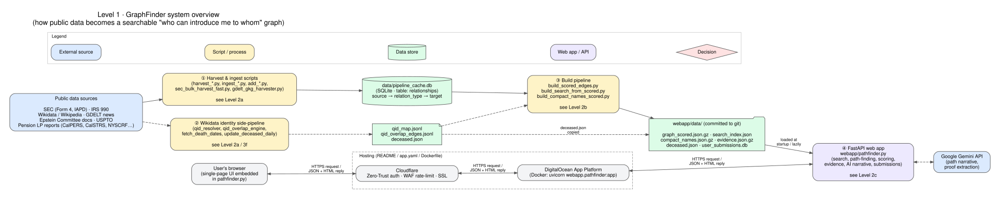

# GraphFinder flowcharts

The charts start with the whole system and get more detailed at each level. Every box names the real script, function or file, so you can jump from a chart straight to the code.

**Colour key:** blue = external data source · amber = script / process · green = data file or database · purple = web app / API · pink diamond = decision · grey = user / browser / hosting

## Level 1: The whole system

| Chart | What it shows |
|---|---|
| [01 · System overview](01-system-overview.svg) | Public sources → harvest scripts → `pipeline_cache.db` → build scripts → `webapp/data/` → FastAPI → browser, plus Cloudflare / DigitalOcean hosting |



## Level 2: The three main subsystems

| Chart | What it shows |
|---|---|
| [02a · Data ingestion](02a-data-ingestion.svg) | Every harvester / ingest script grouped by source (SEC, IRS 990, Wikidata, GDELT, Epstein docs, pension LPs, USPTO), and the Wikidata QID side-pipeline |
| [02b · Build pipeline](02b-build-pipeline.svg) | How `pipeline_cache.db` becomes `graph_scored.json.gz`, `search_index.json` and `compact_names.json.gz`; which builders are legacy |
| [02c · Web app request map](02c-webapp-requests.svg) | Every UI action → HTTP endpoint → data file it reads |

## Level 3: Detailed logic

| Chart | Parent | What it shows |
|---|---|---|
| [03a · build_scored_edges.py](03a-build-scored-edges.svg) | 2b | Row-by-row clean-up rules (dropped relations, person-as-org conflation), overlap merge, pair scoring |
| [03b · Link & path scoring](03b-link-scoring.svg) | 2b, 2c | Raw relation → category → dedup → noisy-OR probability → edge weight → passive / guided path viability, bands, SCI |
| [03c · Path query](03c-path-query.svg) | 2c | `GET /api/path`: name resolution, living-only subgraph, k-shortest paths, Gemini narrative |
| [03d · Name search](03d-name-search.svg) | 2c | `GET /api/search`: the match tiers (100/92/90/50/40/20) and hub boost |
| [03e · User contributions](03e-user-contributions.svg) | 2c | Suggest-link (AI extraction or manual), dispute-link, and in-browser contact matching |
| [03f · Deceased update](03f-deceased-update.svg) | 2a | The daily Wikidata date-of-death cron and how it redeploys |

## Editing / regenerating

The sources are Graphviz files in [`src/`](src/). After editing a `.dot` file, run:

```bash
./docs/flowcharts/render.sh      # needs Graphviz: apt-get install graphviz / brew install graphviz
```

Charts reflect the code as of 2026-11-16. If a script is added or a step changes, update the matching `.dot` file and re-render.
